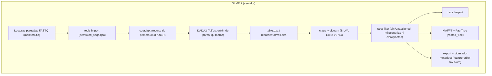
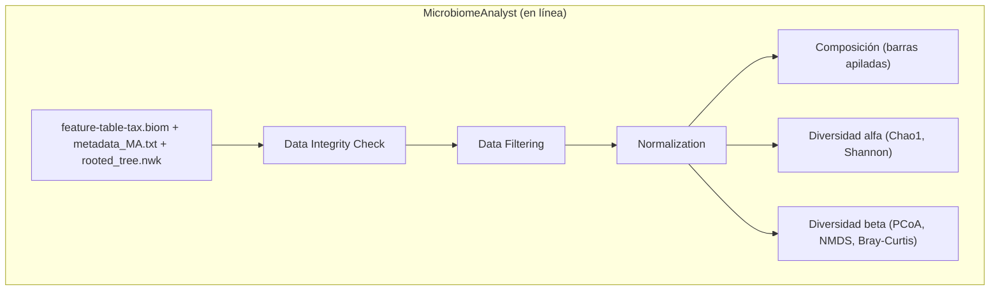

# Semana 12: Análisis metataxonómico de comunidades bacterianas con datos de secuenciación Illumina

## Logro de la sesión:

Al finalizar la sesión, el estudiante utiliza herramientas bioinformáticas para procesar lecturas Illumina del gen 16S rRNA, inferir variantes de secuencia de amplicón (ASVs), asignarles taxonomía y comparar la composición y la diversidad de comunidades bacterianas acuáticas a lo largo de un gradiente altitudinal.

## Estructura de la práctica:

1. Acceso al servidor de cómputo
2. Preparación del entorno y de la base de datos
3. Importación y control de calidad de las lecturas
4. Recorte de los primers con cutadapt
5. Inferencia de ASVs con DADA2
6. Asignación taxonómica con SILVA 138.2
7. Filtrado de ASVs y composición taxonómica
8. Árbol filogenético y exportación de los datos
9. Análisis de diversidad en MicrobiomeAnalyst

> **Cómo está organizada esta práctica:** se analizan los datos públicos de Romero *et al.* (2021, *PLoS ONE* 16: e0250401; BioProject PRJNA646070): muestras de agua superficial del río Rímac tomadas en enero de 2020 en 13 localidades de seis subcuencas, desde Chicla (3 441 m s. n. m.) hasta el puente Gambetta, en el Callao (8 m s. n. m.). Se secuenció la región V3-V4 del gen 16S rRNA (primers 341F/805R) en un MiSeq, con lecturas pareadas de 2 × 251 nt. El set tiene **24 muestras**: una por localidad (01 a 13) y una réplica de 11 de ellas (14 a 24); Chacahuaro y Universitaria no tienen réplica.
>
> Todos los grupos trabajan con el mismo set de datos. El denoising con DADA2 (sección 5) tarda más de seis hora con los datos completos, por lo que **no se ejecuta en clase**: se copian sus salidas desde la carpeta compartida.

## Flujo de trabajo:

### Procesamiento de las lecturas en el servidor (secciones 2 a 8):



### Análisis de diversidad en línea (sección 9):



## Programas requeridos:

### Programas de acceso al servidor:

PuTTY v0.79 https://www.chiark.greenend.org.uk/~sgtatham/putty/latest.html
   - **Descripción:** cliente SSH para establecer conexiones de línea de comandos con el servidor.

WinSCP v6.1 https://winscp.net/eng/download.php
   - **Descripción:** cliente SFTP con interfaz gráfica para transferir archivos entre su computadora y el servidor. En esta práctica se usa para descargar las visualizaciones (`.qzv`) y los archivos que se cargan en MicrobiomeAnalyst.

### Programas bioinformáticos:

QIIME 2 amplicon v2024.10 https://qiime2.org/
   - **Descripción:** QIIME 2 (*Quantitative Insights Into Microbial Ecology*) es una plataforma para analizar datos de amplicones de principio a fin. Trabaja con **artefactos** (`.qza`), que guardan los datos junto con su tipo semántico, y **visualizaciones** (`.qzv`). Cada archivo registra su procedencia: qué comando, con qué parámetros y a partir de qué archivos se generó. En esta práctica se usan los plugins `cutadapt` (recorte de primers), `dada2` (inferencia de ASVs), `feature-classifier` (asignación taxonómica), `taxa` (filtrado y gráficos de barras) y `phylogeny` (MAFFT y FastTree).

biom-format v2 https://biom-format.org/
   - **Descripción:** formato estándar para tablas de abundancia de microbiomas (*Biological Observation Matrix*). El comando `biom`, instalado en el entorno de QIIME 2, se usa para añadir la taxonomía a la tabla de abundancias.

### Bases de datos:

Clasificador Naive Bayes SILVA 138.2 V3-V4 (341F/805R)
   - **Descripción:** SILVA es la base de datos de referencia de genes de ARNr. El clasificador se entrenó con scikit-learn sobre SILVA 138.2 (SSU no redundante al 99 %), curado con RESCRIPt y recortado *in silico* a la región que amplifican los primers 341F/805R. Como solo conoce la región secuenciada, clasifica más rápido, usa menos memoria y suele resolver mejor el género que un clasificador de secuencias completas.

### Herramientas bioinformáticas en línea:

QIIME 2 View https://view.qiime2.org/
   - **Descripción:** visor de los archivos `.qzv` en el navegador. Los datos no se suben a ningún servidor: se procesan en su computadora.

MicrobiomeAnalyst v2.0 https://www.microbiomeanalyst.ca/
   - **Descripción:** plataforma web para el análisis estadístico y visual de datos de microbioma. Su módulo *Marker Data Profiling* (MDP) recibe una tabla de abundancias con taxonomía, la metadata y, opcionalmente, un árbol filogenético, y calcula composición, diversidad alfa y beta, y abundancia diferencial.

## Metodología:

## 1. Acceso al servidor de cómputo:

### Abrir el programa PuTTY, colocar el hostname ( 10.142.250.66 ) y port ( 22 ), y dar clic en Open:


**Figura 1.** Ventana de configuración de PuTTY. En *Host Name* se coloca la dirección IP del servidor y en *Port* el puerto 22 (SSH); el tipo de conexión debe ser SSH.

> **Comentario (figura 1):** antes de abrir la sesión, vaya a **Connection** y en *Seconds between keepalives* escriba **30**. PuTTY enviará una señal cada 30 segundos y la conexión no se cortará por inactividad durante los pasos largos. Si la conexión se cae a mitad de un comando, ese comando se interrumpe y hay que volver a ejecutarlo.

### En la terminal abierta, escribir su usuario y contraseña correspondiente para tener acceso al servidor de cómputo:


**Figura 2.** Terminal de PuTTY al iniciar la sesión. Al escribir la contraseña no se muestran caracteres en pantalla; es el comportamiento normal. Una vez dentro, la línea de comandos indica su usuario y el nombre del servidor.

### Abrir el programa WinSCP, colocar el hostname ( 10.142.250.66 ) y port ( 22 ), escribir su usuario y contraseña correspondiente para tener acceso al servidor de cómputo, y hacer clic en Login:


**Figura 3.** Ventana de inicio de sesión de WinSCP, con el protocolo SFTP, la dirección del servidor, el puerto 22, el usuario y la contraseña.


**Figura 4.** Sesión de WinSCP abierta. El panel izquierdo muestra las carpetas de su computadora y el derecho, las del servidor; los archivos se transfieren arrastrándolos de un panel al otro.

### Uso compartido del servidor

El servidor tiene 64 hilos y 180 GB de RAM, y lo usan **6 grupos a la vez**. Cada grupo usa como máximo **10 hilos** (6 × 10 = 60; quedan 4 para el sistema). No use valores mayores que los indicados en los comandos.

| Sección | Paso | Tiempo aproximado (10 hilos) |
|---|---|---|
| 3 | Importación y reporte de calidad | 5–10 min |
| 4 | cutadapt y reporte de calidad | 5–15 min |
| 5 | DADA2 | más de 6 h: **no se ejecuta**, se copian las salidas |
| 6 | Clasificación taxonómica | 5–20 min |
| 8 | Árbol filogenético (MAFFT + FastTree) | 5–15 min |

> **Comentario:** los tiempos dependen de la carga del servidor. Si un paso no termina a tiempo, copie su resultado desde la carpeta compartida `/data/2026_1/metagenomics/illumina/qiime2/`.

## 2. Preparación del entorno y de la base de datos

### Crear la estructura de carpetas de trabajo

```bash
cd

mkdir metataxonomic

cd metataxonomic

mkdir tmp
```

> **Comentario:**
> - `cd`: sin argumentos, lleva a su carpeta personal (`/home/<usuario>`).
> - `mkdir metataxonomic`: crea la carpeta de trabajo de la práctica.
> - `cd metataxonomic`: entra a esa carpeta.
> - `mkdir tmp`: crea una carpeta para los archivos temporales de QIIME 2.
> - Estos comandos no muestran nada en pantalla cuando funcionan correctamente.

```bash
export TMPDIR=$HOME/metataxonomic/tmp
```

> **Comentario:** QIIME 2 escribe archivos temporales grandes durante cada análisis. La variable `TMPDIR` los dirige a la carpeta `tmp` del usuario y no a `/tmp`, que comparten los 6 grupos y puede llenarse. `$HOME` se reemplaza por la carpeta personal de cada usuario. La variable se pierde al cerrar la terminal: si abre una nueva, ejecute de nuevo esta línea.

### Copiar el clasificador taxonómico

```bash
mkdir database

cd database

cp /data/2026_1/metagenomics/illumina/database/silva138.2_V3V4/silva-138.2-ssu-nr99-V3V4-341f-805r-classifier.qza .
```

> **Comentario:**
> - `mkdir database` y `cd database`: crea la carpeta de la base de datos y entra a ella.
> - `cp ... .`: copia el clasificador a la carpeta actual. El punto final (`.`) significa "aquí".
> - El clasificador se entrenó en el mismo entorno de QIIME 2 (2024.10) que se usa en la práctica. Esto es obligatorio: un clasificador entrenado con otra versión de scikit-learn falla al cargarse.

> **Nota sobre los nombres de los filos:** SILVA 138.2 usa la nomenclatura actual (*Pseudomonadota*, *Bacillota*, *Actinomycetota*, *Campylobacterota*). El artículo de Romero *et al.* usó SILVA 138, con nombres en parte distintos (*Proteobacteria*, *Firmicutes*). Téngalo en cuenta al comparar sus resultados con el artículo.

## 3. Importación y control de calidad de las lecturas

### Obtener los archivos manifest.txt y metadata.txt

```bash
cd ~/metataxonomic

mkdir illumina

cd illumina

conda activate qiime2-amplicon-2024.10
```

> **Comentario:**
> - `cd ~/metataxonomic`: vuelve a la carpeta de trabajo (`~` es su carpeta personal).
> - `mkdir illumina` y `cd illumina`: crea la carpeta del análisis y entra a ella. Todos los comandos de las secciones 3 a 8 se ejecutan aquí.
> - `conda activate qiime2-amplicon-2024.10`: activa el entorno donde está instalado QIIME 2. El nombre del entorno activo aparece entre paréntesis al inicio de la línea de comandos. Si abre una terminal nueva, actívelo otra vez.

```bash
qiime --version

q2cli version 2024.10.1
Run `qiime info` for more version details.
```

> **Comentario:** muestra la versión de QIIME 2. Anótela para la sección de metodología de la bitácora.

```bash
cp /data/2026_1/metagenomics/illumina/qiime2/manifest.txt .

cp /data/2026_1/metagenomics/illumina/qiime2/metadata.txt .
```

> **Comentario:**
> - `manifest.txt`: indica a QIIME 2 qué par de archivos FASTQ (forward y reverse) corresponde a cada muestra, con su ruta absoluta.
> - `metadata.txt`: contiene las variables de cada muestra: la subcuenca (`cuenca`) y la altitud en m s. n. m. (`altitud`).
> - Los archivos se copian ya preparados: al pegar texto en `nano` desde PuTTY, los tabuladores suelen convertirse en espacios y QIIME 2 no puede leer el archivo.

```bash
cat -A manifest.txt | head -n 3

sample-id^Iforward-absolute-filepath^Ireverse-absolute-filepath$
01.Chicla^I/data/2026_1/metagenomics/illumina/raw_data/SRR12217142_1.fastq.gz^I/data/2026_1/metagenomics/illumina/raw_data/SRR12217142_2.fastq.gz$
02.San_Mateo^I/data/2026_1/metagenomics/illumina/raw_data/SRR12217141_1.fastq.gz^I/data/2026_1/metagenomics/illumina/raw_data/SRR12217141_2.fastq.gz$
```

> **Comentario:**
> - **Comando:** `cat -A` muestra el archivo con sus caracteres invisibles: cada tabulador aparece como `^I` y cada final de línea como `$`. `| head -n 3` muestra solo las 3 primeras líneas.
> - **Resultado:** el encabezado tiene las tres columnas que exige el formato `PairedEndFastqManifestPhred33V2`: `sample-id`, `forward-absolute-filepath` y `reverse-absolute-filepath`, separadas por `^I`. Cada muestra tiene dos archivos: `_1.fastq.gz` (lectura forward) y `_2.fastq.gz` (lectura reverse). El nombre `SRR...` es el código de acceso de la corrida en el SRA del NCBI.

```bash
cat -A metadata.txt | head -n 3

Sample ID^Icuenca^Ialtitud$
01.Chicla^IUpper_Rimac^I3441$
02.San_Mateo^IParac-Upper_Rimac^I3422$
```

> **Comentario:** la metadata tiene tres columnas separadas por tabuladores. QIIME 2 acepta varios nombres para la primera columna (`Sample ID`, `sample-id`, `#SampleID`); lo importante es que los identificadores coincidan exactamente con los del manifest.

Correspondencia entre muestras, corridas del SRA y variables (contenido de `manifest.txt` y `metadata.txt`):

| Muestra | Réplica | Corrida SRA (muestra / réplica) | Subcuenca (`cuenca`) | Altitud (m) |
|---|---|---|---|---|
| 01.Chicla | 14.Chicla | SRR12217142 / SRR13224180 | Upper_Rimac | 3 441 |
| 02.San_Mateo | 15.San_Mateo | SRR12217141 / SRR13224179 | Parac-Upper_Rimac | 3 422 |
| 03.Tamboraque | 16.Tamboraque | SRR12217133 / SRR13224178 | Parac-Upper_Rimac | 3 023 |
| 04.Huanchor | 17.Huanchor | SRR12217132 / SRR13224177 | Santa_Eulalia-Parac | 2 868 |
| 05.Chacahuaro | – | SRR12217130 | Santa_Eulalia-Parac | 2 526 |
| 06.Santa_Eulalia | 18.Santa_Eulalia | SRR12217131 / SRR13224176 | Santa_Eulalia | 948 |
| 07.Chaclacayo | 19.Chaclacayo | SRR12217129 / SRR13224175 | Jicamarca-Santa_Eulalia | 657 |
| 08.Huachipa | 20.Huachipa | SRR12217128 / SRR13224174 | Jicamarca-Santa_Eulalia | 396 |
| 09.Libertadores | 21.Libertadores | SRR12217127 / SRR13224173 | Lower_Rimac | 213 |
| 10.Nuevo | 22.Nuevo | SRR12217126 / SRR13224172 | Lower_Rimac | 200 |
| 11.Universitaria | – | SRR13224171 | Lower_Rimac | 69 |
| 12.Faucett | 23.Faucett | SRR12217139 / SRR12217140 | Lower_Rimac | 33 |
| 13.Gambetta | 24.Gambetta | SRR12217138 / SRR13224170 | Lower_Rimac | 8 |

### Importar las lecturas a QIIME 2

```bash
qiime tools import --type 'SampleData[PairedEndSequencesWithQuality]' --input-path manifest.txt --input-format PairedEndFastqManifestPhred33V2 --output-path demuxed_seqs.qza
```

> **Comentario (comando):**
> - `--type 'SampleData[PairedEndSequencesWithQuality]'`: tipo semántico del artefacto: lecturas pareadas, con calidad, separadas por muestra.
> - `--input-path manifest.txt`: archivo con la ruta de los FASTQ de cada muestra.
> - `--input-format PairedEndFastqManifestPhred33V2`: formato del manifest. *PairedEnd*, lecturas pareadas; *Phred33*, la calidad de cada base está codificada como un carácter ASCII con desplazamiento 33 (el estándar de Illumina actual); *V2*, manifest separado por tabuladores.
> - `--output-path demuxed_seqs.qza`: artefacto de salida con las 24 muestras.
>
> **Comentario (resultado):** QIIME 2 confirma que importó el manifest y creó `demuxed_seqs.qza`. Si alguna ruta del manifest no existe, el comando se detiene e indica qué archivo de qué muestra no encontró.

```bash
qiime tools peek demuxed_seqs.qza

UUID:        0672b33e-4680-4064-8ac8-229fd820335f
Type:        SampleData[PairedEndSequencesWithQuality]
Data format: SingleLanePerSamplePairedEndFastqDirFmt
```

> **Comentario:**
> - **Comando:** `qiime tools peek` muestra la información básica de un artefacto sin abrirlo.
> - **Resultado:** `UUID` es el identificador único del artefacto (el suyo será distinto: cada ejecución genera uno nuevo); `Type`, su tipo semántico; y `Data format`, el formato interno de los datos: un par de archivos FASTQ por muestra, de un solo carril de secuenciación.

### Crear la carpeta de visualizaciones y generar el reporte de calidad

```bash
mkdir visualization
```

> **Comentario:** crea la carpeta donde se guardarán todas las visualizaciones (`.qzv`) de la práctica.

```bash
qiime demux summarize --i-data demuxed_seqs.qza --o-visualization visualization/seqs_quality.qzv
```

> **Comentario:**
> - `--i-data demuxed_seqs.qza`: lecturas importadas.
> - `--o-visualization visualization/seqs_quality.qzv`: reporte de salida.
> - El gráfico de calidad se calcula sobre una submuestra aleatoria de 10 000 lecturas (opción `--p-n`, que se deja en su valor por defecto).

### Descargar con WinSCP el archivo `seqs_quality.qzv` y abrirlo en QIIME 2 View (https://view.qiime2.org/)

> **Punto de control:** Anote el número de lecturas de cada muestra y la posición en la que empieza a caer la calidad de cada lectura. Los usará para explicar los resultados de DADA2.

## 4. Recorte de los primers con cutadapt

Las lecturas empiezan con la secuencia del primer, que no es información biológica de la muestra: proviene del oligonucleótido sintético usado en la PCR. Además, los primers tienen posiciones degeneradas que DADA2 interpretaría como variación real. Por eso se eliminan antes del denoising.

```bash
qiime cutadapt trim-paired --i-demultiplexed-sequences demuxed_seqs.qza --p-front-f CCTACGGGNGGCWGCAG --p-front-r GACTACHVGGGTATCTAATCC --p-minimum-length 100 --p-discard-untrimmed --p-cores 10 --o-trimmed-sequences demuxed_seqs_trimmed.qza
```

> **Comentario (comando):**
> - `--i-demultiplexed-sequences demuxed_seqs.qza`: lecturas pareadas de entrada.
> - `--p-front-f CCTACGGGNGGCWGCAG`: primer forward 341F. *front* indica que se busca en el extremo 5′ de la lectura forward, y se elimina junto con todo lo que esté antes de él. Las letras N, W, H y V son códigos IUPAC de bases degeneradas (N = cualquier base; W = A o T; H = A, C o T; V = A, C o G).
> - `--p-front-r GACTACHVGGGTATCTAATCC`: primer reverse 805R, buscado en el extremo 5′ de la lectura reverse.
> - `--p-minimum-length 100`: descarta las lecturas que quedan con menos de 100 nt después del recorte.
> - `--p-discard-untrimmed`: descarta las lecturas en las que no se encontró el primer (productos inespecíficos o artefactos).
> - `--p-cores 10`: número de hilos.
> - `--o-trimmed-sequences demuxed_seqs_trimmed.qza`: lecturas recortadas.
> - Cutadapt acepta por defecto hasta un 10 % de diferencias entre el primer y la lectura (`--p-error-rate 0.1`).
> - En el protocolo Illumina 16S, la lectura empieza en el primer específico y no en la cola del adaptador; por eso basta con buscar el primer.

```bash
qiime demux summarize --i-data demuxed_seqs_trimmed.qza --o-visualization visualization/seqs_quality_trimmed.qzv
```

> **Comentario:** genera el mismo reporte de calidad, ahora con las lecturas recortadas, para comparar el antes y el después.

### Descargar `seqs_quality_trimmed.qzv` y compararlo con `seqs_quality.qzv` en QIIME 2 View

> **Punto de control:** ¿Cuántas lecturas se perdieron en cada muestra con el recorte? Con la longitud del amplicón y de las lecturas recortadas, calcule cuántos nucleótidos se superponen. ¿Qué pasaría si se truncaran las lecturas en las posiciones 200 y 200?

## 5. Inferencia de ASVs con DADA2

DADA2 aprende de los propios datos un modelo de los errores de la corrida y lo usa para corregir cada lectura. El resultado son **variantes de secuencia de amplicón (ASVs)**: secuencias exactas, que pueden diferir de otras en un solo nucleótido, en lugar de los OTUs agrupados al 97 % que se usaban antes.

### Comando usado (no se ejecuta en clase)

```bash
qiime dada2 denoise-paired --i-demultiplexed-seqs demuxed_seqs_trimmed.qza --p-trunc-len-f 0 --p-trunc-len-r 0 --p-n-threads 20 --o-table table.qza --o-representative-sequences representatives.qza --o-denoising-stats denoising_stats.qza
```

> **Comentario (comando):**
> - `--i-demultiplexed-seqs demuxed_seqs_trimmed.qza`: lecturas sin primers.
> - `--p-trunc-len-f 0` y `--p-trunc-len-r 0`: posición en la que se corta cada lectura antes del análisis. Con `0` no se truncan.
> - `--p-n-threads 20`: número de hilos.
> - `--o-table table.qza`: tabla de abundancias (cuántas lecturas tiene cada ASV en cada muestra).
> - `--o-representative-sequences representatives.qza`: la secuencia de cada ASV.
> - `--o-denoising-stats denoising_stats.qza`: cuántas lecturas sobreviven en cada etapa.
> - **Opciones que no se escriben** y quedan en su valor por defecto:
>   - `--p-max-ee-f 2` y `--p-max-ee-r 2`: descarta las lecturas con más de 2 errores esperados, calculados a partir de la calidad de cada base. Es el mismo filtro (`maxEE = 2`) que usaron Romero *et al.*
>   - `--p-trunc-q 2`: corta la lectura en la primera base con calidad ≤ 2.
>   - `--p-min-overlap 12`: solapamiento mínimo para unir las lecturas forward y reverse.
>   - `--p-pooling-method independent`: cada muestra se procesa por separado.
>   - `--p-chimera-method consensus`: método de detección de quimeras.
>   - `--p-n-reads-learn 1000000`: número de lecturas usadas para aprender el modelo de errores. Es la etapa más lenta.
> - Las etapas de DADA2 son: filtrado por calidad → aprendizaje del modelo de errores → denoising de cada muestra → unión de pares → eliminación de quimeras.

### Copiar las salidas de DADA2 a la carpeta de trabajo

```bash
cp /data/2026_1/metagenomics/illumina/qiime2/table.qza .

cp /data/2026_1/metagenomics/illumina/qiime2/representatives.qza .

cp /data/2026_1/metagenomics/illumina/qiime2/denoising_stats.qza .
```

> **Comentario:** copia a la carpeta actual (`~/metataxonomic/illumina`) las tres salidas de DADA2, generadas con el comando anterior.

### Generar los reportes del denoising

```bash
qiime metadata tabulate --m-input-file denoising_stats.qza --o-visualization visualization/denoising_stats.qzv
```

> **Comentario:**
> - `--m-input-file denoising_stats.qza`: estadísticas de DADA2. `metadata tabulate` convierte en una tabla interactiva cualquier artefacto que pueda leerse como metadata.
> - `--o-visualization visualization/denoising_stats.qzv`: tabla de salida.

```bash
qiime feature-table summarize --i-table table.qza --m-sample-metadata-file metadata.txt --o-visualization visualization/table_denoised.qzv
```

> **Comentario:**
> - `--i-table table.qza`: tabla de abundancias de DADA2.
> - `--m-sample-metadata-file metadata.txt`: metadata de las muestras; en la pestaña *Interactive Sample Detail* permite ver cuántas muestras de cada subcuenca se conservarían con una profundidad de muestreo dada.
> - `--o-visualization visualization/table_denoised.qzv`: reporte de salida.

```bash
qiime feature-table tabulate-seqs --i-data representatives.qza --o-visualization visualization/representatives.qzv
```

> **Comentario:**
> - `--i-data representatives.qza`: secuencias de los ASVs.
> - `--o-visualization visualization/representatives.qzv`: tabla con la secuencia y la longitud de cada ASV.

### Descargar los tres reportes y abrirlos en QIIME 2 View

> **Comentario:**
> - Columnas: `input` (pares de entrada), `filtered` (pasan el filtro de calidad), `denoised` (quedan tras el denoising), `merged` (forward y reverse se unieron), `non-chimeric` (no son quiméricas) y los porcentajes de `filtered`, `merged` y `non-chimeric` respecto a la entrada. Las primeras filas:
>
> | Muestra | input | filtered | denoised | merged | non-chimeric | % non-chimeric |
> |---|---|---|---|---|---|---|
> | 01.Chicla | 269 928 | 191 317 | 180 865 | 121 477 | 97 653 | 36,18 |
> | 02.San_Mateo | 280 021 | 199 324 | 187 378 | 127 848 | 103 896 | 37,10 |
> | 03.Tamboraque | 268 032 | 190 905 | 179 133 | 118 605 | 88 390 | 32,98 |
> | 11.Universitaria | 103 981 | 69 887 | 65 344 | 45 056 | 35 456 | 34,10 |
>
> - **Filtrado:** pasa el **67–75 %** de los pares (72 % en promedio). Como no se truncaron las lecturas, las colas de baja calidad acumulan errores esperados y muchas lecturas superan el límite de `maxEE = 2`.
> - **Unión de pares:** es la etapa con **mayor pérdida**: solo se une el 67 % de los pares que llegan a ella, y queda el 38–50 % de la entrada. El solapamiento es corto (35–60 nt) y cae justo en el extremo de peor calidad de las dos lecturas: las diferencias en esa zona impiden unirlas.
> - **Quimeras:** se elimina alrededor del 23 % de las lecturas unidas.
> - **Resultado final:** se conserva el **30–41 %** de los pares de cada muestra (35 % en promedio), con un promedio de **83 966 lecturas por muestra**; 11.Universitaria es la de menor profundidad (35 456).
> - Los valores de `input` pueden diferir en unas pocas lecturas de los de `seqs_quality_trimmed.qzv`: las salidas que se copiaron se generaron con una versión anterior del recorte, que incluía la cola del adaptador.

> **Punto de control:** ¿En qué etapa de DADA2 se pierden más lecturas? Relacione esa pérdida con la calidad de las lecturas (figura 6) y con el solapamiento que calculó en la sección 4. ¿Qué parámetro de DADA2 cambiaría para recuperar más lecturas, y qué riesgo tendría ese cambio?

## 6. Asignación taxonómica con SILVA 138.2

```bash
qiime feature-classifier classify-sklearn --i-classifier ~/metataxonomic/database/silva-138.2-ssu-nr99-V3V4-341f-805r-classifier.qza --i-reads representatives.qza --p-n-jobs 3 --p-reads-per-batch 2000 --o-classification taxa.qza

Saved FeatureData[Taxonomy] to: taxa.qza
```

> **Comentario (comando):**
> - `--i-classifier`: clasificador entrenado (sección 2).
> - `--i-reads representatives.qza`: secuencias de los ASVs.
> - `--p-n-jobs 3`: número de procesos en paralelo. Cada proceso carga su propia copia del clasificador (~6 GB de RAM); con 3 procesos por grupo y 6 grupos, el servidor usa unos 110 GB de sus 180 GB. Por eso no se usan más.
> - `--p-reads-per-batch 2000`: número de secuencias que procesa cada proceso por vez; valores menores reducen la memoria que se usa.
> - `--o-classification taxa.qza`: taxonomía asignada a cada ASV.
> - **Opción por defecto:** `--p-confidence 0.7`. El clasificador predice el linaje nivel por nivel, desde dominio hasta género, y solo asigna un nivel si la confianza es de al menos 0,7; si no la alcanza, la clasificación se detiene en el nivel anterior.

```bash
qiime metadata tabulate --m-input-file taxa.qza --o-visualization visualization/taxa.qzv
```

> **Comentario:** convierte la taxonomía en una tabla interactiva, con una fila por ASV.

### Descargar `taxa.qzv` y abrirlo en QIIME 2 View

### Exportar la taxonomía y cuantificar la resolución de la asignación

```bash
qiime tools export --input-path taxa.qza --output-path exported_taxonomy
```

> **Comentario:**
> - `--input-path taxa.qza`: artefacto a exportar.
> - `--output-path exported_taxonomy`: carpeta de salida, que contendrá el archivo `taxonomy.tsv`.
> - `qiime tools export` extrae los datos de un artefacto en un formato estándar que otros programas pueden leer.

```bash
head -n 3 exported_taxonomy/taxonomy.tsv

Feature ID      Taxon   Confidence
dcd4030bd55a4bbc6d5d935b8ba2797d        d__Bacteria;p__Campylobacterota;c__Campylobacteria;o__Campylobacterales;f__Arcobacteraceae;g__Arcobacter;s__    0.9999999995602877
6db4c5fe1f48ff886ffeb57d1dfabb2d        d__Bacteria;p__Fusobacteriota;c__Fusobacteriia;o__Fusobacteriales;f__Leptotrichiaceae;g__Hypnocyclicus;s__       0.9999999999862439
```

> **Comentario:**
> - **Comando:** `head -n 3` muestra las primeras 3 líneas: el encabezado y dos ASVs.
> - **Resultado:** el primer ASV es un *Arcobacter* (Campylobacterota) y el segundo, un *Hypnocyclicus* (Fusobacteriota), ambos con una confianza cercana a 1. Son los dos géneros que el artículo destaca: *Arcobacter* en el Rímac bajo y *Hypnocyclicus* en la parte alta.

```bash
tail -n +2 exported_taxonomy/taxonomy.tsv | wc -l

13298
```

> **Comentario:** `tail -n +2` muestra el archivo desde la línea 2 (sin el encabezado) y `wc -l` cuenta las líneas: hay **13 298 ASVs** clasificados, uno por línea.

```bash
grep -c "p__" exported_taxonomy/taxonomy.tsv

13235
```

```bash
grep -c "f__" exported_taxonomy/taxonomy.tsv

12678
```

```bash
grep -c "g__" exported_taxonomy/taxonomy.tsv

11804
```

> **Comentario:**
> - **Comando:** `grep -c` cuenta las líneas que contienen el texto indicado. Cuando el clasificador no alcanza la confianza en un nivel, el linaje termina en el nivel anterior y el prefijo no aparece; por eso contar `p__`, `f__` o `g__` equivale a contar los ASVs clasificados hasta ese rango.
> - **Resultado:** el **99,5 %** de los ASVs se clasificó hasta filo (13 235), el **95,3 %** hasta familia (12 678) y el **88,8 %** hasta género (11 804). Romero *et al.* reportan 95–99 % de asignación hasta familia y 84 % hasta género con SILVA 138 completo.

```bash
grep -c "Unassigned" exported_taxonomy/taxonomy.tsv

1
```

```bash
grep -c "d__Archaea" exported_taxonomy/taxonomy.tsv

38
```

```bash
grep -c "Mitochondria" exported_taxonomy/taxonomy.tsv

34
```

```bash
grep -c "Chloroplast" exported_taxonomy/taxonomy.tsv

72
```

> **Comentario:**
> - **Resultado:** 1 ASV no se pudo asignar ni siquiera a dominio (`Unassigned`) y 38 son arqueas: los primers 341F/805R amplifican sobre todo bacterias. Hay **34 ASVs de mitocondrias y 72 de cloroplastos**: no son bacterias de vida libre, sino el gen 16S de los organelos de eucariotas (algas, restos vegetales) presentes en el agua. Se eliminan en la sección 7.
> - Además, 62 ASVs se clasificaron solo hasta dominio (13 298 − 13 235 − 1 = 62).

> **Punto de control:** ¿Qué porcentaje de los ASVs llega a género? ¿Por qué la resolución disminuye de filo a género? ¿Qué ventaja tiene un clasificador recortado a la región V3-V4 frente a uno de secuencias completas?

## 7. Filtrado de ASVs y composición taxonómica

### Filtrar los ASVs según su clasificación

```bash
qiime taxa filter-table --i-table table.qza --i-taxonomy taxa.qza --p-include p__ --p-exclude mitochondria,chloroplast --o-filtered-table table_f.qza
```

> **Comentario:**
> - `--i-table table.qza`: tabla de abundancias sin filtrar.
> - `--i-taxonomy taxa.qza`: taxonomía de cada ASV.
> - `--p-include p__`: conserva solo los ASVs cuya taxonomía contiene `p__`, es decir, los clasificados al menos hasta filo. Elimina el ASV `Unassigned` y los 62 que solo llegan a dominio.
> - `--p-exclude mitochondria,chloroplast`: elimina los ASVs cuya taxonomía contiene alguno de estos términos (separados por coma, sin distinguir mayúsculas de minúsculas).
> - `--o-filtered-table table_f.qza`: tabla filtrada. Quedan **13 129 ASVs** (13 298 − 1 − 62 − 34 − 72).

```bash
qiime taxa filter-seqs --i-sequences representatives.qza --i-taxonomy taxa.qza --p-include p__ --p-exclude mitochondria,chloroplast --o-filtered-sequences representatives_f.qza
```

> **Comentario:**
> - `--i-sequences representatives.qza`: secuencias de los ASVs sin filtrar.
> - `--i-taxonomy`, `--p-include` y `--p-exclude`: los mismos criterios del comando anterior, para que la tabla y las secuencias tengan exactamente los mismos ASVs.
> - `--o-filtered-sequences representatives_f.qza`: secuencias filtradas, que se usan para construir el árbol filogenético.

### Gráfico de barras de la composición taxonómica

```bash
qiime taxa barplot --i-table table_f.qza --i-taxonomy taxa.qza --m-metadata-file metadata.txt --o-visualization visualization/taxa_barplot.qzv
```

> **Comentario:**
> - `--i-table table_f.qza`: tabla filtrada.
> - `--i-taxonomy taxa.qza`: taxonomía de cada ASV.
> - `--m-metadata-file metadata.txt`: metadata; permite ordenar las barras por subcuenca o por altitud.
> - `--o-visualization visualization/taxa_barplot.qzv`: gráfico de barras interactivo.

### Descargar `taxa_barplot.qzv` y abrirlo en QIIME 2 View

> **Punto de control:** Cambie al nivel 6 (género). ¿Qué géneros dominan en las subcuencas altas y cuáles en el Rímac bajo? ¿Coinciden con los que reporta el artículo? Busque en la literatura qué tipo de ambiente o de contaminación indica cada uno. Este análisis forma parte de los resultados de la bitácora.

## 8. Árbol filogenético y exportación de los datos

### Construir el árbol filogenético de los ASVs

```bash
qiime phylogeny align-to-tree-mafft-fasttree --i-sequences representatives_f.qza --p-n-threads 10 --o-alignment aligned_representatives.qza --o-masked-alignment masked_aligned_representatives.qza --o-tree unrooted_tree.qza --o-rooted-tree rooted_tree.qza

Saved FeatureData[AlignedSequence] to: aligned_representatives.qza
Saved FeatureData[AlignedSequence] to: masked_aligned_representatives.qza
Saved Phylogeny[Unrooted] to: unrooted_tree.qza
Saved Phylogeny[Rooted] to: rooted_tree.qza
```

> **Comentario (comando):**
> - `--i-sequences representatives_f.qza`: secuencias de los ASVs filtrados.
> - `--p-n-threads 10`: número de hilos.
> - `--o-alignment aligned_representatives.qza`: alineamiento múltiple de las secuencias, obtenido con MAFFT.
> - `--o-masked-alignment masked_aligned_representatives.qza`: el mismo alineamiento sin las columnas muy variables o con muchos huecos, que agregan ruido a la filogenia.
> - `--o-tree unrooted_tree.qza`: árbol sin raíz inferido con FastTree (máxima verosimilitud aproximada).
> - `--o-rooted-tree rooted_tree.qza`: el mismo árbol, enraizado en el punto medio de la rama más larga.
>
> **Comentario (resultado):** se generan cuatro artefactos, uno por cada salida. El árbol enraizado permite calcular métricas que consideran el parentesco entre los ASVs: UniFrac (diversidad beta) y la diversidad filogenética de Faith (diversidad alfa).

### Exportar la tabla de abundancias y el árbol

```bash
qiime tools export --input-path table_f.qza --output-path exported_table
```

> **Comentario:** exporta la tabla filtrada en formato BIOM (versión 2.1). La carpeta `exported_table` contiene el archivo `feature-table.biom`.

```bash
qiime tools export --input-path rooted_tree.qza --output-path exported_tree
```

> **Comentario:** exporta el árbol enraizado en formato Newick, un formato de texto que representa el árbol con paréntesis y longitudes de rama. La carpeta `exported_tree` contiene el archivo `tree.nwk`.

### Ajustar el encabezado de la taxonomía y generar el archivo BIOM con taxonomía

```bash
sed -i '1s/.*/#OTUID\ttaxonomy\tconfidence/' exported_taxonomy/taxonomy.tsv
```

> **Comentario:**
> - `sed`: editor de texto en la línea de comandos.
> - `-i`: modifica el archivo directamente.
> - `1s/.*/…/`: en la línea 1, reemplaza (`s`) la línea completa (`.*`) por el texto indicado.
> - `#OTUID\ttaxonomy\tconfidence`: el nuevo encabezado; `\t` es un tabulador.
> - El encabezado original (`Feature ID  Taxon  Confidence`) se cambia porque el comando `biom` espera que las columnas se llamen `#OTUID`, `taxonomy` y `confidence`.

```bash
head -n 2 exported_taxonomy/taxonomy.tsv

#OTUID  taxonomy        confidence
dcd4030bd55a4bbc6d5d935b8ba2797d        d__Bacteria;p__Campylobacterota;c__Campylobacteria;o__Campylobacterales;f__Arcobacteraceae;g__Arcobacter;s__    0.9999999995602877
```

> **Comentario:** el encabezado cambió y el resto del archivo quedó igual.

```bash
biom add-metadata -i exported_table/feature-table.biom -o feature-table-tax.biom --observation-metadata-fp exported_taxonomy/taxonomy.tsv --observation-header OTUID,taxonomy,confidence --sc-separated taxonomy
```

> **Comentario:**
> - `-i exported_table/feature-table.biom`: tabla de abundancias exportada.
> - `-o feature-table-tax.biom`: tabla de salida, con la taxonomía incorporada.
> - `--observation-metadata-fp exported_taxonomy/taxonomy.tsv`: archivo con la información de cada ASV. En el formato BIOM, los ASVs son las *observations* y las muestras, las *samples*.
> - `--observation-header OTUID,taxonomy,confidence`: nombres de las columnas de ese archivo, en orden.
> - `--sc-separated taxonomy`: indica que la columna `taxonomy` contiene niveles separados por punto y coma (*semicolon-separated*), para guardarlos como una lista ordenada de rangos.
> - Solo se incorpora la taxonomía de los ASVs que están en la tabla filtrada; el comando no muestra nada en pantalla.

```bash
biom summarize-table -i feature-table-tax.biom | head -n 12
```

> **Comentario:** resume la tabla BIOM. Verifique que indique **24 muestras** (`Num samples`), **13 129 ASVs** (`Num observations`) y **2 009 113 lecturas** (`Total count`), y que en `Observation Metadata Categories` aparezcan `taxonomy` y `confidence`. Es la comprobación de que la tabla está completa y lleva la taxonomía antes de cargarla en MicrobiomeAnalyst. En el resumen por muestra, el mínimo (35 404 lecturas) corresponde a 11.Universitaria y el máximo (113 259), a 04.Huanchor.

### Preparar la metadata y el árbol para MicrobiomeAnalyst

```bash
sed '1s/^[^\t]*/#NAME/' metadata.txt > metadata_MA.txt
```

> **Comentario:**
> - `1s/^[^\t]*/#NAME/`: en la línea 1, reemplaza el texto desde el inicio de la línea (`^`) hasta el primer tabulador (`[^\t]*`) por `#NAME`. Es decir, cambia el nombre de la primera columna.
> - `> metadata_MA.txt`: guarda el resultado en un archivo nuevo. Sin la opción `-i`, `metadata.txt` no se modifica y se sigue usando en QIIME 2.

```bash
head -n 3 metadata_MA.txt

#NAME   cuenca  altitud
01.Chicla       Upper_Rimac     3441
02.San_Mateo    Parac-Upper_Rimac       3422
```

> **Comentario:** MicrobiomeAnalyst exige que la primera columna de la metadata se llame `#NAME`; las demás columnas no cambian.

```bash
cp exported_tree/tree.nwk rooted_tree.nwk
```

> **Comentario:** copia el árbol a la carpeta de trabajo con un nombre que indica que es el árbol enraizado.

### Descargar con WinSCP los archivos `feature-table-tax.biom`, `metadata_MA.txt` y `rooted_tree.nwk`

## 9. Análisis de diversidad en MicrobiomeAnalyst

> **Importante:** use el servidor oficial, https://www.microbiomeanalyst.ca. El servidor de desarrollo (`dev.microbiomeanalyst.ca`) puede dar errores sin mensaje en el paso de normalización.

### Ir a MicrobiomeAnalyst, entrar al módulo *Marker Data Profiling* y cargar los tres archivos

### Estructura de carpetas esperada al finalizar

```bash
~/metataxonomic/
├── tmp/                                    # Temporales de QIIME 2 (TMPDIR)
├── database/
│   └── silva-138.2-ssu-nr99-V3V4-341f-805r-classifier.qza   # Clasificador SILVA 138.2 V3-V4
└── illumina/
    ├── manifest.txt                        # Rutas de los FASTQ de cada muestra
    ├── metadata.txt                        # Metadata para QIIME 2
    ├── metadata_MA.txt                     # Metadata para MicrobiomeAnalyst (#NAME)
    ├── demuxed_seqs.qza                    # Lecturas importadas
    ├── demuxed_seqs_trimmed.qza            # Lecturas sin primers (cutadapt)
    ├── table.qza                           # Tabla de abundancias de DADA2 (copiada)
    ├── representatives.qza                 # Secuencias de los ASVs (copiadas)
    ├── denoising_stats.qza                 # Estadísticas de DADA2 (copiadas)
    ├── taxa.qza                            # Taxonomía de los ASVs
    ├── table_f.qza                         # Tabla filtrada
    ├── representatives_f.qza               # Secuencias filtradas
    ├── aligned_representatives.qza         # Alineamiento (MAFFT)
    ├── masked_aligned_representatives.qza  # Alineamiento enmascarado
    ├── unrooted_tree.qza                   # Árbol sin raíz (FastTree)
    ├── rooted_tree.qza                     # Árbol enraizado
    ├── rooted_tree.nwk                     # Árbol enraizado (Newick, para MicrobiomeAnalyst)
    ├── feature-table-tax.biom              # Tabla con taxonomía (para MicrobiomeAnalyst)
    ├── exported_table/                     # feature-table.biom
    ├── exported_taxonomy/                  # taxonomy.tsv
    ├── exported_tree/                      # tree.nwk
    └── visualization/
        ├── seqs_quality.qzv
        ├── seqs_quality_trimmed.qzv
        ├── denoising_stats.qzv
        ├── table_denoised.qzv
        ├── representatives.qzv
        ├── taxa.qzv
        └── taxa_barplot.qzv
```


